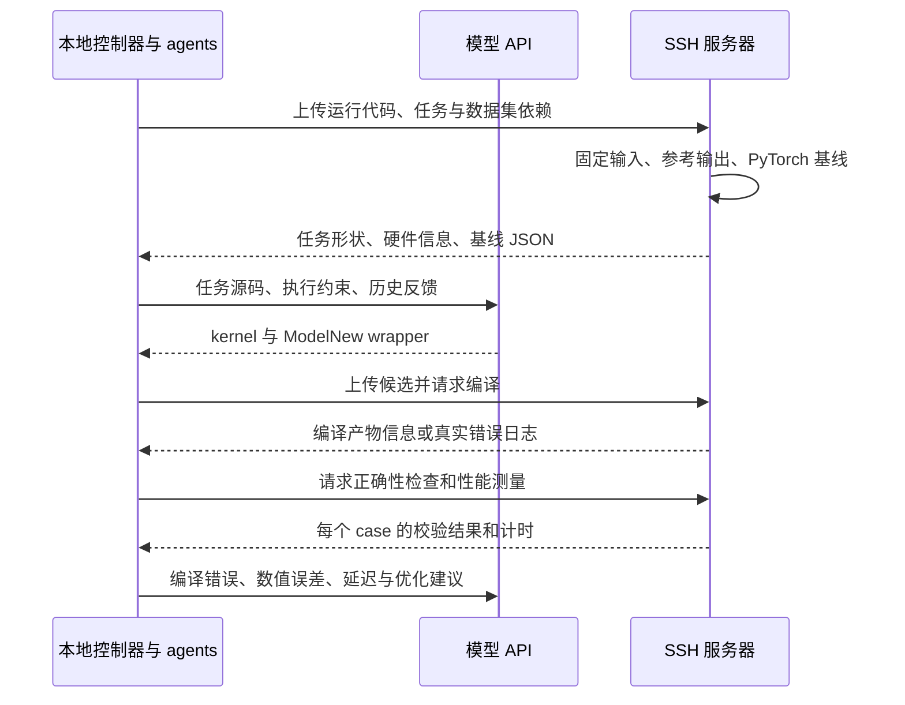

# 本地 LLM + 离线服务器执行

这个副本位于 `D:\code\study\lab317\agent\Astra-remote`，开发分支为
`cpu-gpu-remote-execution`。本地原始 `Astra` 和服务器 `hzh/Astra` 的代码不被修改。

## 分工与数据流



Orchestrator、CodeGenerator、CorrectnessTester、Benchmarker、OptimizationStrategist
均在本地运行，并沿用既有迭代逻辑。`--executor ssh` 将编译和执行工具切到服务器；
`--executor local` 保留本机模式。清单批量运行也支持这些参数，每个任务串行创建独立工作区。

任务的 `Model`、`get_inputs` / `get_inputs_dyn_list` 和 `get_init_inputs` 在服务器执行。
`reference.pt` 中的输入、模型状态、期望输出和输入修改结果留在服务器，整个运行复用同一个快照。
本地不导入 PyTorch，不进行交叉编译，也不需要下载 Arm 的依赖。
上传的数据集来自选定的 `--dataset-root`，包含其非隐藏文件以保留任务依赖；不上传本地 `.env`、
Git 目录、虚拟环境、缓存和已有构建目录。数据集依赖若位于 root 之外，需先整理进 root。

## 环境

本地需要 Python 3.10+，以及当前用户已能使用的 `ssh armv8_sve` / `scp`。
依赖放进本地独立环境即可：

```powershell
cd D:\code\study\lab317\agent\Astra-remote
python -m venv .venv
.\.venv\Scripts\python.exe -m pip install -r requirements-controller.txt
```

服务器只需已有的 PyTorch、NumPy、Ninja、C++ 编译器；GPU 还需对应 CUDA 工具链。
模型 SDK 不需要在服务器安装。默认使用此前已经创建的
`/mnt/data_nvme4n1/lab317_cnndev/hzh/Astra/.venv/bin/python`，只读取该环境。
编译子进程会补上虚拟环境及其基础环境的工具路径，无需修改共享 shell 或 Conda 环境。

默认所有新增服务器文件都位于：

```text
/mnt/data_nvme4n1/lab317_cnndev/hzh/Astra-remote/runs/<运行ID>/
    astra/          # 本次上传的 worker 代码
    dataset/        # 本次上传的任务与依赖
    reference/      # reference.json、reference.pt、baseline.json
    candidates/v1/ # 源码、共享库、校验结果和日志
    .cache/
```

运行通过 SSH 调用 Python，不需要服务端监听端口，也不需要服务端联网。
传输文件限于项目代码、数据集和候选源码，API 密钥不写入请求或上传包。
模型 API 仍由本地网络访问。不要把密钥写进 kernel、wrapper 或数据集。

## 不调用模型的实际验证

示例是明确标注的**手写**实现，用于检查远程链路；它们不是 LLM 的生成结果。
NEON 使用 `vaddq_f32`，SVE 使用运行时 lane 数和尾部 predicate，支持两维连续 FP32 矩阵
与单行广播，是 AKG `elemwise_add_001.py` 的最小运行样例。

```powershell
# 使用系统 Python 也可以：这些操作不需要模型 SDK 或本地 PyTorch。
.\run_remote.ps1 -PrepareOnly
.\run_remote.ps1 -Target neon -EvaluateOnly "$PWD/examples/remote_add/neon"
.\run_remote.ps1 -Target sve -EvaluateOnly "$PWD/examples/remote_add/sve"
```

`--evaluate-only` 会将示例复制到本次本地运行的 `v1` 后再上传，不修改示例。
服务器校验输出 shape、dtype、device、数值及输入修改，全部通过后才计时。

## 实际模型生成与优化

在本地终端设置 `OPENAI_API_KEY`，兼容接口再设置 `OPENAI_BASE_URL`。
不要把密钥放在命令行参数、聊天或 Git 中。默认不开启 SDK tracing。
配置好后运行：

```powershell
.\run_remote.ps1 -Python .\.venv\Scripts\python.exe `
  -Target neon -Model YOUR_MODEL -ModelApi chat_completions -MaxIterations 3
```

官方 Responses 接口可用 `-ModelApi responses`。模型名应填写账号实际可用的模型。
`MaxIterations 0` 只生成并评测 v1；`3` 表示 v1 后再尝试三轮。
编译失败、数值不符和执行错误都会进入迭代记录并反馈给后续优化 agent。
生成 agent 即使没有调用其编译工具，控制器也会强制实际编译、检查和测量。

完整 CLI 可指定其他任务、服务器或 GPU：

```powershell
python -B kernel_optimizer.py --dataset akg --dataset-root benchmarks/akg `
  --task static_shape/elemwise/elemwise_add_001.py --target sve `
  --executor ssh --ssh-host armv8_sve `
  --remote-root /mnt/data_nvme4n1/lab317_cnndev/hzh/Astra-remote `
  --remote-python /mnt/data_nvme4n1/lab317_cnndev/hzh/Astra/.venv/bin/python `
  --model YOUR_MODEL --model-api chat_completions --max-iterations 3
```

CUDA 使用 `--target cuda` 和有可用 GPU、CUDA PyTorch、nvcc 的 SSH 主机，
同时指定该主机自己的 `--remote-root` 和 `--remote-python`。CUDA 远程模式尚待 GPU 实机验证。

## 结果、超时和恢复

本地 `optimization_runs/<运行ID>/` 保存源码、任务与硬件描述、编译日志、校验与性能 JSON，
完整生成流程还会输出既有 CSV/JSON 汇总。`remote.json` 标明 SSH 主机与远程工作区，
`.transfer/` 保存每次请求及返回响应，方便排查本地到服务器的实际交互。
原生共享库只留在服务器，本地不加载它。

CPU 默认使用服务器允许的第一个逻辑核、单线程。`--cpu-core` 指的是**服务器**核号。
基线与候选都在服务器计时；上传、SSH 往返、输入克隆、状态恢复不计入 kernel 测量，
输出分配和 Python wrapper 调用包含在 CPU 测量边界内。

`--compile-timeout`、`--execution-timeout` 控制服务端工作时限，
`--transfer-timeout` 控制上传和下载。服务器有独立的工作超时，网络中断不意味着测量成功。
连接错误会保留为失败反馈；当前没有断点恢复或自动重放模型请求。
远程工作区不会自动删除，便于复查，后续清理只应针对新副本的运行目录。

实际模型生成仍需安装本地 `requirements-controller.txt` 并配置模型 API。
远程执行示例通过，不等于已经验证任意任务或 LLM 生成质量。

## 本次实际验证（2026-11-15）

Windows 本地控制器通过 `armv8_sve` 执行 AKG
`static_shape/elemwise/elemwise_add_001.py`：输入 FP32 `[16, 2048]` 与 `[1, 2048]`。
服务器为实际探测到支持 ASIMD/SVE 的 AArch64 主机，PyTorch `2.7.1+cpu`、GCC `10.3.1`。
CPU 单线程并固定核，预热 3 次，采样 10 次，延迟为包含 wrapper 和输出分配的中位数。

| 目标 | 编译与正确性 | PyTorch 基线 | 手写候选 | 本地运行目录 |
| --- | --- | ---: | ---: | --- |
| NEON | 通过 | 9.570 μs | 11.515 μs | `optimization_runs/20261115_205232_639416` |
| SVE | 通过 | 9.665 μs | 10.265 μs | `optimization_runs/20261115_205452_385790` |

这些简单候选没有超过 PyTorch 基线，数字仅证明实际执行并回传了结果。
这次未调用模型 API，也未验证 CUDA 远程执行。

同一个远程工作区还实际验证了：正确候选通过；把原生加法改成减法后返回数值失败且不计时；
无效 C++ 的编译错误返回本地；编译失败后恢复旧源码能重新上传，修复为加法后重新通过。
本地验证进程未导入 PyTorch 或 agents。反馈记录在
`optimization_runs/feedback_20261115_205609_902629/feedback_smoke.json`。

首次实跑发现并修复了未激活虚拟环境导致 Ninja 不在 PATH 的问题。
完整日志保留在本地与 `hzh/Astra-remote/runs/` 对应工作区；原始项目代码未改动。
